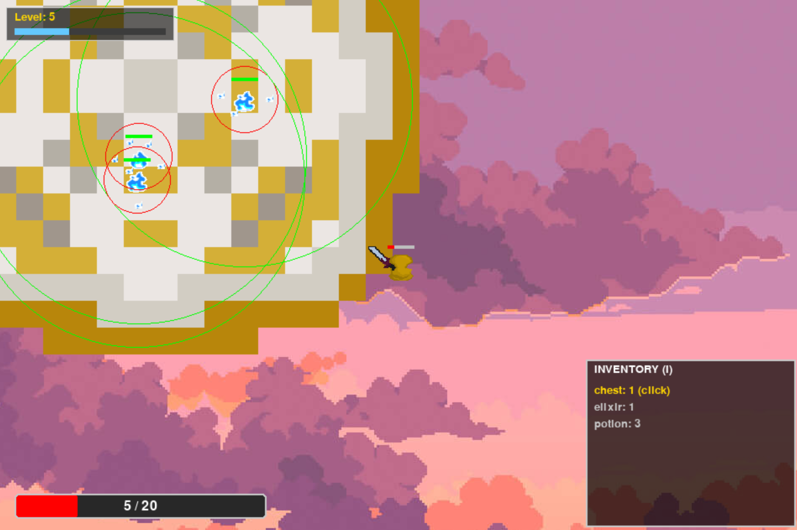
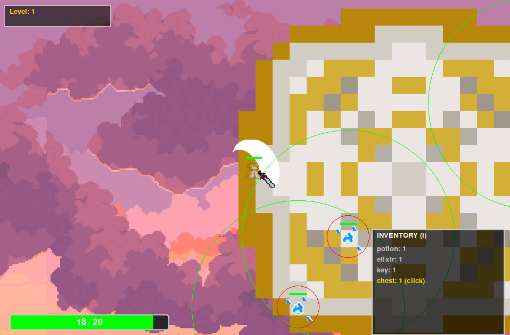

**Download:** the Windows executable is available under [Releases](https://github.com/zenpeter-123/RPG-minigame/releases/latest).

# RPG Minigame with an HMM-based Sphinx

A small top-down action RPG written in Python with pygame. Besides fighting enemies, the player meets a **sphinx that estimates the player's knowledge with a Hidden Markov Model** and adapts its questions to it.



**Download:** the Windows executable is available under [Releases](https://github.com/zenpeter-123/RPG-minigame/releases/latest).

## Algorithms

**Hidden Markov Model (the sphinx).** The sphinx asks questions in three subjects: math, history and literature.
The player's hidden state is a skill level (weak, medium or good) in each subject, which gives 3 × 3 × 3 = 27 hidden states.
Every answer is an observation (subject and correct/incorrect), and the forward–backward algorithm estimates the current skill levels from the noisy sequence of answers. The sphinx then picks questions that match the estimated level in each subject.
The HMM, forward–backward, Viterbi and Baum–Welch algorithms are implemented from scratch in `hmm.py`.

**Breadth-first search (enemies).** Enemies use BFS on the tile grid to find a path to the player within their line of sight.
Outside of it they move randomly, with directions computed using vector math (scalar products).



## Controls

| Key | Action |
|---|---|
| Arrow keys | Move |
| Space | Attack |
| I | Inventory |
| B | Shop |
| Q / E / C | Use potion / elixir / chest |

## Run from source

```bash
pip install pygame numpy
python main.py
```

## Project structure

| File | Description |
|---|---|
| `main.py` | Game loop and event handling |
| `sprites.py` | Player, enemies, items, BFS pathfinding |
| `hmm.py` | HMM, forward–backward, Viterbi and Baum–Welch implementations |
| `sphinx_hmm.py` | The sphinx's 27-state skill model |
| `sphinx_ui.py`, `questions.py` | Question pop-up and question bank |
| `tiled_loader.py`, `map.json` | Loads the map made in the Tiled editor |
| `config.py`, `utils.py` | Settings and helpers |
